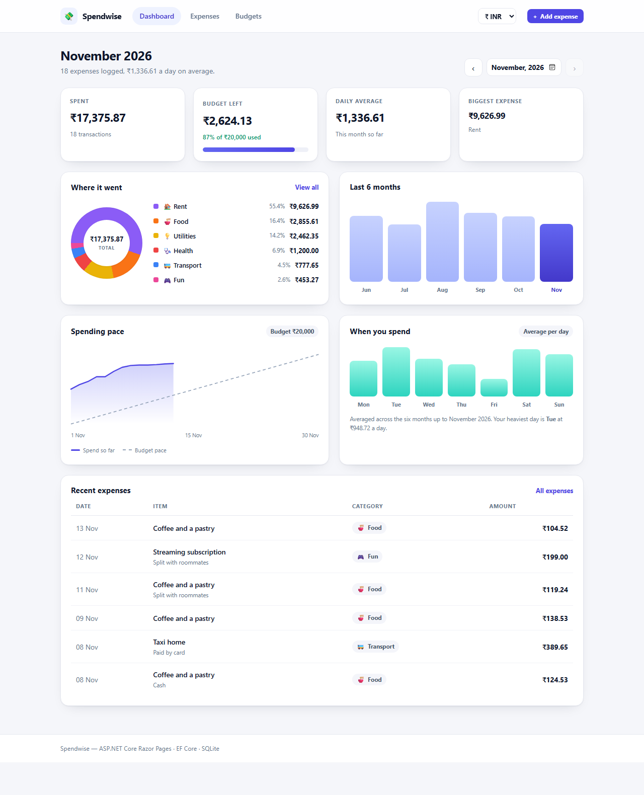
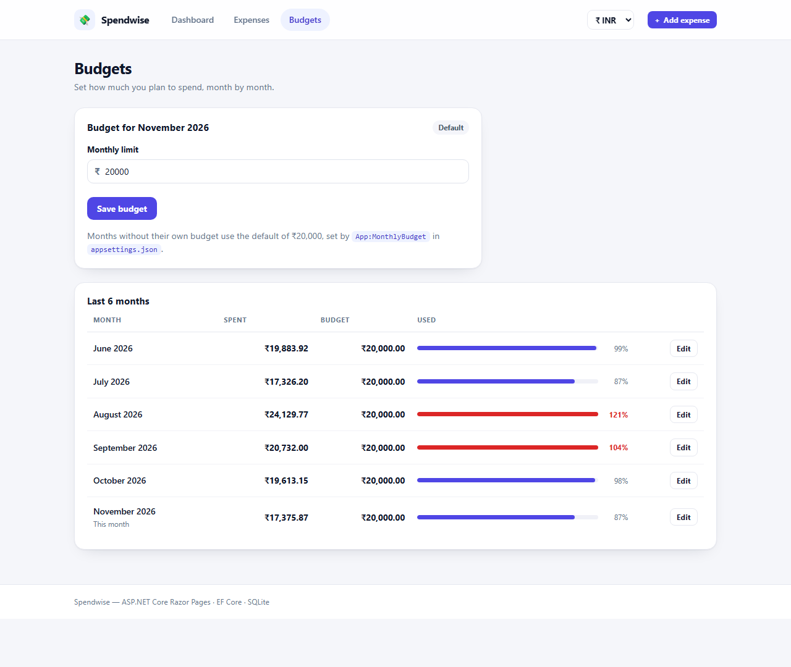

# SpendWise — an ASP.NET Core expense tracker

[](LICENSE)
[](https://dotnet.microsoft.com/)

A small, complete expense tracker built with ASP.NET Core Razor Pages, EF Core and SQLite.
Log what you spend, then see where the money actually went: monthly totals, a category
donut, a six-month trend, a cumulative pace line and a day-of-week pattern.

It runs entirely on `localhost` — no hosting, no accounts, no external services, and no
internet connection needed at runtime (Bootstrap and jQuery are served from `wwwroot/lib`).



## Features

- **Dashboard** for any month: total spent, budget left, daily average, biggest single expense
- **Budget page** — set a limit for any month, see six months of spend-vs-budget history, reset a month to the default
- **Category donut** with a legend: per-category colour, share and amount
- **Cumulative "spending pace" line** — this month's running total against a dashed budget pace, drawn as inline SVG
- **Day-of-week bars** — average spend per weekday over six months, so the expensive days are obvious
- **Six-month trend chart** drawn with plain CSS — no chart library
- **Full CRUD** for expenses with server-side + client-side validation
- **Filtering and paging** on the expenses list (search, category, month)
- **Delete all** — clears every expense behind a confirmation page that shows the count and total first
- **Seeded demo data** — six months of believable spending on first run
- **Currency picker** — ₹, $, €, £ in the header, remembered in a cookie; rupees use Indian digit grouping (₹1,23,456.78)
- **Exact money handling** — amounts are stored as integer cents, not floating point

## Requirements

- [.NET SDK 10](https://dotnet.microsoft.com/download) (`dotnet --version` should print `10.x`)
- Nothing else. No SQL Server, no Docker, no Node.

## Run it

```bash
dotnet run
```

Then open <http://localhost:5000> (or whatever port the console prints).

On first start the app creates `expenses.db`, applies the EF Core migration and seeds six
months of sample data. Delete `expenses.db` to get a fresh start.

## Project layout

```
ExpenseTracker/
├── Data/
│   ├── AppDbContext.cs      EF Core context + column configuration
│   └── DbSeeder.cs          demo data inserted on first run
├── Migrations/              generated schema history (dotnet ef)
├── Models/
│   ├── Expense.cs           the entity + validation rules
│   ├── Budget.cs            one spending limit per month
│   └── CategoryCatalog.cs   categories and colours
├── Pages/
│   ├── Index.cshtml         dashboard
│   ├── Budgets/             set and review monthly budgets
│   └── Expenses/            list, create, edit, delete, delete-all
├── Services/
│   ├── ExpenseService.cs    queries and dashboard maths
│   ├── ChartGeometry.cs     SVG paths for the cumulative pace chart
│   ├── BudgetService.cs     budget lookup, overrides and defaults
│   └── CurrencyService.cs   per-request currency + formatting
├── wwwroot/css/site.css     all styling (no build step)
├── appsettings.json         connection string, currency, budget
└── Program.cs               DI, database setup, startup seeding
```

## Configuration

`appsettings.json`:

| Key | Meaning |
| --- | --- |
| `App:DefaultCurrency` | Currency used before anyone picks one: `INR`, `USD`, `EUR` or `GBP` |
| `App:MonthlyBudget` | Budget used by the meter on the dashboard (in the default currency) |
| `ConnectionStrings:DefaultConnection` | SQLite file location |

The picker in the header writes a `spendwise.currency` cookie and redirects back to the
page you were on, so the choice survives navigation without changing any URLs.

## Budgets

A budget is a limit for one month, stored in the `Budgets` table keyed by the first day of
that month. Lookup order:

1. the row for that month, if one exists
2. otherwise `App:MonthlyBudget` from `appsettings.json`

That means the app works before you set anything, and "Use the default" simply deletes the
override. The Budgets page shows the last six months so you can see which ones ran over.

The dashboard's budget card links straight to the page for the month you are viewing.



## Charts

Four charts, zero libraries — all of them are CSS or inline SVG, so nothing is fetched at
runtime:

| Chart | How it is drawn |
| --- | --- |
| Category donut | `ExpenseService.BuildDonut` turns the category shares into a single `conic-gradient()` string; a white circle with the month's total sits on top |
| Six-month trend | flexbox columns, each bar's `height` set to a percentage of the biggest month |
| Spending pace | inline SVG paths from `ChartGeometry` — a polyline, an area fill underneath, and a dashed budget line |
| Day of week | the same flexbox bar markup with a compact modifier |

`ChartGeometry` returns finished path strings rather than raw numbers, because SVG path data
must always use `.` as the decimal separator — a server set to a European culture would
otherwise emit commas and break the drawing. All number formatting inside it therefore goes
through `CultureInfo.InvariantCulture`.

The pace chart stops at today for the current month instead of flat-lining across days that
have not happened yet, and it hides itself entirely when nothing has been spent.

## Deleting everything

`Expenses → Delete all` opens a confirmation page showing how many rows and how much money
is about to disappear, then runs a single `ExecuteDeleteAsync()` — one SQL statement rather
than loading every entity. Budgets are deliberately left untouched.

## Currency

`CurrencyService` reads a cookie (`spendwise.currency`), falls back to
`App:DefaultCurrency`, and formats through the matching culture — so `INR` prints
`₹1,23,456.78` while `USD` prints `$123,456.78`. The header picker posts to the tiny
`SetCurrency` page, which stores the cookie and redirects back to wherever you were.

Adding another currency is one line in `CurrencyService.Supported`.

## License

SpendWise is open source software licensed under the [MIT License](LICENSE).

## How money is stored

SQLite has no native `decimal` type, so EF Core would normally store money as text and
silently break `SUM` and `ORDER BY`. Instead `AppDbContext` maps `Expense.Amount` to an
`INTEGER` column holding whole cents:

```csharp
expense.Property(e => e.Amount)
    .HasConversion(
        value => (long)Math.Round(value * 100m),
        cents => cents / 100m);
```

The dashboard sums in C# rather than SQL, which keeps totals exact and avoids provider
quirks. Worth explaining in a viva — it is the kind of detail that separates a working
project from a thoughtful one.

## Database changes

The EF tool is pinned as a local tool (see `dotnet-tools.json`), so no global install:

```bash
dotnet tool restore
dotnet ef migrations add SomeChange
dotnet ef database update
```
